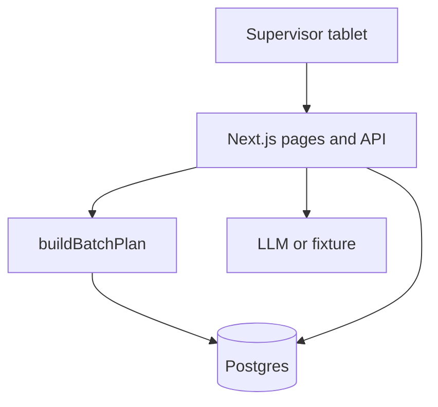

# Architecture — Lò Ovenfloor

## Modules

| Path | Role |
| --- | --- |
| `src/server/batch-plan.ts` | Pure planning math |
| `src/server/release-policy.ts` | Roles and override detection |
| `src/server/plan-input.ts` | DB → plan input |
| `src/lib/ai/client.ts` | Demo/live/fallback + number guard |
| `prisma/` | Schema, migrations, seed |

## AI

Structured output via Vercel AI SDK `generateObject` with Zod. Override questions short-circuit to refusal without calling the model.
