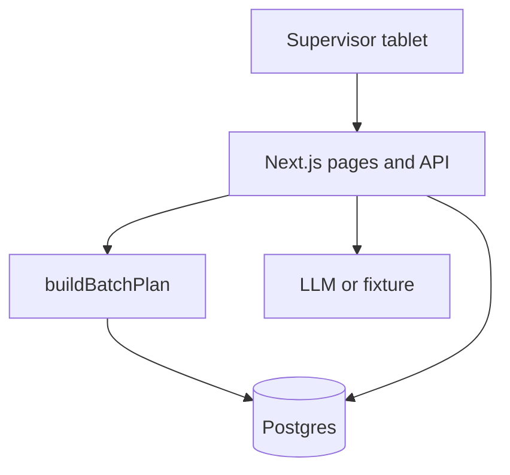

# SPEC — Lò Ovenfloor

Portfolio demonstration for a fictional HCMC bakery operations programme. Not a live production system.

Product name on screen: **Lò**. Kicker: `OVENFLOOR · PORTFOLIO`.

## Product vision

A supervisor in a demo HCMC kitchen opens a tablet at the end of the day and sees tomorrow’s batches already counted from outlet demand, leftovers, waste history, eggs on hand, and oven slots. The language is Vietnamese first. The model can explain the plan. It cannot change a quantity. A person releases the plan, and the release is audited.

This app owns **manufacturing** and **operations**. It does not take payment and it does not store customer personal data.

## Personas

| Persona | Need on this app |
| --- | --- |
| Lan Phạm, production supervisor | Release or adjust tomorrow’s plan on a tablet. Record waste reasons. |
| Minh Trần, demand planner | See which demand lines were excluded as stale, and the resulting batches. |
| Ánh Đặng, director | Read one screen that says whether tomorrow is released and what is blocked. No extra analytics suite. |
| Hà Lê, finance | Out of scope here. She is a Tillbridge persona. |
| Khoa Võ, sales | Out of scope here except that gift-box demand arrives as a SKU signal. |

Demo roles in the cookie `demo_role`: `supervisor` (Lan), `planner` (Minh), `sponsor` (Ánh).

| Action | supervisor | planner | sponsor |
| --- | --- | --- | --- |
| Read floor, plan, process, waste | yes | yes | yes |
| Draft / refresh the explanation | yes | yes | yes |
| Edit a draft line and apply the oven suggestion | yes | yes | no |
| Release the plan | yes | no | no |
| Record a waste event | yes | no | no |
| Edit process requirement text | yes | yes | no |

## User stories

1. As Lan, I open tomorrow and see each SKU’s demand, leftover, buffer, and planned trays, so I can start the night without a spreadsheet.
2. As Lan, I see pandan reduced because eggs are short, so I trust the cut is a stock fact.
3. As Minh, I see the Phú Mỹ Hưng country-loaf signal kept out of the plan because it is stale, so we do not bake from an old note.
4. As Lan, I cannot release while the ovens are over capacity, so a polite model cannot overbook the deck.
5. As Lan, I can apply the suggested biscuit cut and then release, so the human step is one explicit button.
6. As Lan, I ask in Vietnamese why pandan changed and get an answer that cites the plan, so I can explain it to the night shift.
7. As Lan, I ask the agent to set croissants to 500 and get a refusal, so the floor learns the boundary.
8. As Minh, I open the process map from mix through dispatch and from demand through waste, and each step has a requirement id.
9. As Lan, I record today’s waste against a fixed reason list.
10. As Ánh, I see the plan status and the latest audit line without being able to release it myself.

## Demo facts the seed and the tests must share

Business today: **2026-11-02**. Plan date: **2026-11-03**. Timezone: Asia/Ho_Chi_Minh.

Firm demand is the sum of counter signals with `captured_at` on or after **2026-11-01T00:00:00+07:00**. The stale line is `SD-CAM` at `CTR-PMH`, qty **12**, captured **2026-10-28T08:00:00+07:00**, and it must not enter `demand_qty`.

| SKU | NH | TD | PMH firm | Leftover at KIT-D3 | Waste rate | History days | Batch | Planned before oven suggestion | Slots | Flags |
| --- | ---: | ---: | ---: | ---: | ---: | ---: | ---: | ---: | ---: | --- |
| `BM-PAT` | 30 | 30 | 20 | 10 | 0.05 | 10 | 10 | 80 | 8 | |
| `CR-BUT` | 40 | 36 | 20 | 8 | 0.10 | 14 | 12 | 108 | 9 | |
| `TT-EGG` | 16 | 16 | 16 | 0 | 0.08 | 10 | 12 | 60 | 5 | |
| `BL-PAN` | 8 | 8 | 8 | 0 | 0.08 | 10 | 8 | 16 | 2 | `INGREDIENT` |
| `SD-CAM` | 10 | 8 | 0 | 0 | 0.08 | 8 | 6 | 24 | 4 | `STALE_DEMAND` |
| `TR-LY` | 8 | 4 | 4 | 16 | 0.08 | 6 | 8 | 8 | 1 | |
| `GN-QUE` | 4 | 4 | 4 | 0 | 0.08 default | 3 | 6 | 18 | 3 | `LOW_HISTORY` |
| `GQ-TET` | 3 | 1 | 1 | 0 | 0.00 | 6 | 1 | 5 | 0 | not baked |

Pandan before the egg cut would have been 32 (see formula). Eggs on hand are **20**. Recipe `rcp-bl-pan` yields **8** portions and uses **10** eggs. Largest fit is **16**. Other ingredients are on hand at **100000** so they do not constrain.

Oven slots: Oven A 4×4 = 16, Oven B 4×3 = 12, Oven C 1×1 = 1, total **29**. Load of the table is **32**. Flag `OVEN_OVER`. The human suggestion sets `GN-QUE` planned qty to **0**, load becomes 29, and release is then allowed. Gift boxes use no oven.

Yield history ends **2026-11-01**. For each SKU with a fixed rate, every observation has that exact waste/produced ratio (for example produced 100 and waste 10 for croissant). `GN-QUE` has exactly 3 observations. Median of an even count is the average of the two middle values; equal observations keep the rate exact.

## Planning rules

Implement `buildBatchPlan(input)` as a pure function. The UI, the API, the seed preview, and the tests call it. The model never supplies these numbers.

```
rate = history_days >= 5 ? median(waste_qty / produced_qty) : 0.08
if history_days < 5: flag LOW_HISTORY
rate = min(rate, 0.25)
buffer = ceil(demand_qty * rate)
raw = demand_qty + buffer - leftover_qty
if raw <= 0: planned = 0
else planned = ceil(raw / batch_multiple) * batch_multiple
```

Then ingredients: for each ingredient, `need = planned / yield_units * qty_per_yield`. If any ingredient is short, reduce that SKU to the largest whole-batch quantity that fits the tightest ingredient and flag `INGREDIENT`.

Then ovens: baked SKUs consume `planned / batch_multiple` slots. If the sum exceeds capacity, flag `OVEN_OVER` and do not change quantities. `canRelease` is false while `OVEN_OVER` is set or while status is not an edited draft that fits.

Stale signals are listed on the line as excluded qty and `STALE_DEMAND`. They are not inside `demand_qty`.

Worked check the tests must lock:

- Croissant: buffer `ceil(96 * 0.10) = 10`, raw `96 + 10 - 8 = 98`, planned `ceil(98 / 12) * 12 = 108`.
- Pandan before eggs: buffer `ceil(24 * 0.08) = 2`, raw `26`, planned `32`, then eggs reduce it to `16`.
- Ginger: history forces rate `0.08`, buffer `ceil(12 * 0.08) = 1`, raw `13`, planned `18`.

## Process map

Route `/process`. Two streams, in this order.

Manufacturing, owner on the step:

1. Scale ingredients — storekeeper — clipboard — pain: scales and the sheet disagree.
2. Mix and rest — baker — clipboard.
3. Divide and shape — baker — clipboard.
4. Proof — baker — clipboard.
5. Bake — baker — oven — pain: decks are overbooked on Saturdays.
6. Cool — baker — rack.
7. Pack and label — packer — clipboard.
8. Dispatch to counters — driver — paper run sheet.

Operations:

1. Read tomorrow’s outlet demand — planner — POS import.
2. Check leftover finished goods — supervisor — rack count.
3. Check ingredient coverage — storekeeper — stores sheet.
4. Draft the batch plan — supervisor — Ovenfloor — pain: the draft lives in chat and changes.
5. Supervisor releases the plan — supervisor — Ovenfloor.
6. Record yield and waste the next afternoon — supervisor — waste book — pain: reasons are free text.

Each step has `name_en`, `name_vi`, `owner_role`, `input`, `output`, `system_name`, `pain_en`, `pain_vi`, and one requirement. Seed requirements `OF-R01` through `OF-R08` with the statements in the root `ARCHITECTURE.md` crosswalk. Map `OF-R01` to draft plan, `OF-R02` to read demand, `OF-R03` to ingredient coverage, `OF-R04` to bake, `OF-R05` to record waste, `OF-R06` to draft plan, `OF-R07` to release, `OF-R08` to the manufacturing stream as a whole (attach it to “Bake” if a step needs a single parent, and also show it in the page intro).

## Screens

| Route | Purpose |
| --- | --- |
| `/` | Tomorrow’s plan for KIT-D3. Headline `Đêm nay nướng gì` / `What bakes tomorrow`. Sub `Kế hoạch mẻ 3 tháng 11 · Bếp demo Quận 3`. Oven slot summary. Blocked release state. |
| `/process` | Both streams and requirement cards. |
| `/waste` | Last 14 days by reason, and a form to add an event for 2026-11-02. |
| `/demand` | Signals for 2026-11-03 with the stale row marked. |
| `/agent` | Also available as a panel on `/`. Question box, answer, flags, mode banner. |
| `/trust` | Static, readable limits: stale data, thin history, model drift, demo mode. |

Tablet width first (1024). The release button is visible without a hover. Desktop still has the same columns, with more air.

Wordmark **Lò** in Fraunces italic. Footer disclaimer in the active locale.

## Tech stack

- Next.js current stable, App Router, TypeScript, Tailwind, ESLint, npm, `src/`, alias `@/*`.
- Prisma + Neon Postgres. Money and quantities are integers.
- Vercel AI SDK structured output via `@ai-sdk/openai`. Zod on every boundary.
- Tests: `tsx --test` on explicit files.
- No chart library, no UI kit theme, no Python service.

Create the app with `create-next-app` using TypeScript, Tailwind, ESLint, App Router, and `src/`. Record the flags in the README. Then replace the sample homepage.

## Folder structure

```
projects/lo-ovenfloor/
  SPEC.md
  README.md
  SECURITY.md
  ARCHITECTURE.md
  DEMO_URL.txt
  .env.example
  .gitignore
  package.json
  prisma/schema.prisma
  prisma/migrations/
  prisma/seed.ts
  src/app/layout.tsx
  src/app/page.tsx
  src/app/globals.css
  src/app/process/page.tsx
  src/app/waste/page.tsx
  src/app/demand/page.tsx
  src/app/trust/page.tsx
  src/app/api/health/route.ts
  src/app/api/floor/today/route.ts
  src/app/api/plan/route.ts
  src/app/api/plan/suggestion/route.ts
  src/app/api/plan/release/route.ts
  src/app/api/waste/route.ts
  src/app/api/process/route.ts
  src/app/api/agent/route.ts
  src/app/api/session/role/route.ts
  src/components/SiteHeader.tsx
  src/components/DisclaimerFooter.tsx
  src/components/AiModeBanner.tsx
  src/components/TrustPanel.tsx
  src/components/PlanTable.tsx
  src/i18n/en.ts
  src/i18n/vi.ts
  src/lib/db.ts
  src/lib/format.ts
  src/lib/session.ts
  src/lib/ai/client.ts
  src/lib/ai/demo-fixtures.ts
  src/server/batch-plan.ts
  src/server/release-policy.ts
  src/server/plan-input.ts
  tests/batch-plan.test.ts
  tests/release-policy.test.ts
```

## SQL schema

Prisma models must implement these tables and checks. Table names may be snake_case via `@@map`.

```sql
CREATE TABLE outlet (
  id TEXT PRIMARY KEY,
  name TEXT NOT NULL,
  kind TEXT NOT NULL CHECK (kind IN ('kitchen', 'counter')),
  district TEXT NOT NULL
);

CREATE TABLE sku (
  id TEXT PRIMARY KEY,
  name_en TEXT NOT NULL,
  name_vi TEXT NOT NULL,
  batch_multiple INT NOT NULL CHECK (batch_multiple > 0),
  baked BOOLEAN NOT NULL,
  active BOOLEAN NOT NULL DEFAULT TRUE
);

CREATE TABLE ingredient (
  id TEXT PRIMARY KEY,
  name_en TEXT NOT NULL,
  name_vi TEXT NOT NULL,
  unit TEXT NOT NULL
);

CREATE TABLE ingredient_on_hand (
  ingredient_id TEXT PRIMARY KEY REFERENCES ingredient(id),
  qty INT NOT NULL CHECK (qty >= 0),
  as_of TIMESTAMPTZ NOT NULL
);

CREATE TABLE recipe (
  id TEXT PRIMARY KEY,
  sku_id TEXT NOT NULL UNIQUE REFERENCES sku(id),
  yield_units INT NOT NULL CHECK (yield_units > 0)
);

CREATE TABLE recipe_line (
  recipe_id TEXT NOT NULL REFERENCES recipe(id),
  ingredient_id TEXT NOT NULL REFERENCES ingredient(id),
  qty_per_yield INT NOT NULL CHECK (qty_per_yield > 0),
  PRIMARY KEY (recipe_id, ingredient_id)
);

CREATE TABLE oven (
  id TEXT PRIMARY KEY,
  name TEXT NOT NULL,
  decks INT NOT NULL CHECK (decks > 0),
  bakes_per_day INT NOT NULL CHECK (bakes_per_day > 0)
);

CREATE TABLE demand_signal (
  id TEXT PRIMARY KEY,
  outlet_id TEXT NOT NULL REFERENCES outlet(id),
  sku_id TEXT NOT NULL REFERENCES sku(id),
  for_date DATE NOT NULL,
  qty INT NOT NULL CHECK (qty >= 0),
  source TEXT NOT NULL CHECK (source IN ('pos_import', 'planner')),
  captured_at TIMESTAMPTZ NOT NULL
);

CREATE TABLE finished_on_hand (
  outlet_id TEXT NOT NULL REFERENCES outlet(id),
  sku_id TEXT NOT NULL REFERENCES sku(id),
  qty INT NOT NULL CHECK (qty >= 0),
  as_of DATE NOT NULL,
  PRIMARY KEY (outlet_id, sku_id, as_of)
);

CREATE TABLE yield_observation (
  sku_id TEXT NOT NULL REFERENCES sku(id),
  event_date DATE NOT NULL,
  produced_qty INT NOT NULL CHECK (produced_qty > 0),
  waste_qty INT NOT NULL CHECK (waste_qty >= 0),
  PRIMARY KEY (sku_id, event_date)
);

CREATE TABLE waste_event (
  id TEXT PRIMARY KEY,
  outlet_id TEXT NOT NULL REFERENCES outlet(id),
  sku_id TEXT NOT NULL REFERENCES sku(id),
  event_date DATE NOT NULL,
  qty INT NOT NULL CHECK (qty > 0),
  reason TEXT NOT NULL CHECK (reason IN ('overproof', 'burn', 'stale', 'trim', 'unsold', 'other')),
  note TEXT,
  recorded_by TEXT NOT NULL
);

CREATE TABLE batch_plan (
  id TEXT PRIMARY KEY,
  for_date DATE NOT NULL,
  status TEXT NOT NULL CHECK (status IN ('draft', 'released', 'superseded')),
  mode TEXT NOT NULL CHECK (mode IN ('demo', 'live', 'fallback')),
  narrative_en TEXT,
  narrative_vi TEXT,
  failure_flags TEXT[] NOT NULL DEFAULT '{}',
  created_by TEXT NOT NULL,
  released_by TEXT,
  created_at TIMESTAMPTZ NOT NULL DEFAULT now()
);

CREATE TABLE batch_line (
  id TEXT PRIMARY KEY,
  plan_id TEXT NOT NULL REFERENCES batch_plan(id),
  sku_id TEXT NOT NULL REFERENCES sku(id),
  demand_qty INT NOT NULL,
  excluded_stale_qty INT NOT NULL DEFAULT 0,
  leftover_qty INT NOT NULL,
  waste_buffer_qty INT NOT NULL,
  planned_qty INT NOT NULL,
  slots INT NOT NULL,
  constrained_by TEXT CHECK (constrained_by IN ('ingredient', 'oven', 'none')),
  flags TEXT[] NOT NULL DEFAULT '{}'
);

CREATE TABLE process_step (
  id TEXT PRIMARY KEY,
  stream TEXT NOT NULL CHECK (stream IN ('manufacturing', 'operations')),
  sort_order INT NOT NULL,
  name_en TEXT NOT NULL,
  name_vi TEXT NOT NULL,
  owner_role TEXT NOT NULL,
  input_en TEXT NOT NULL,
  output_en TEXT NOT NULL,
  system_name TEXT NOT NULL,
  pain_en TEXT NOT NULL,
  pain_vi TEXT NOT NULL
);

CREATE TABLE requirement (
  id TEXT PRIMARY KEY,
  step_id TEXT NOT NULL REFERENCES process_step(id),
  statement_en TEXT NOT NULL,
  statement_vi TEXT NOT NULL,
  priority TEXT NOT NULL CHECK (priority IN ('now', 'next', 'later')),
  acceptance_en TEXT NOT NULL
);

CREATE TABLE agent_run (
  id TEXT PRIMARY KEY,
  kind TEXT NOT NULL CHECK (kind IN ('plan_explain', 'floor_question')),
  mode TEXT NOT NULL CHECK (mode IN ('demo', 'live', 'fallback')),
  question TEXT,
  input_json JSONB NOT NULL,
  output_json JSONB NOT NULL,
  failure_flags TEXT[] NOT NULL DEFAULT '{}',
  created_at TIMESTAMPTZ NOT NULL DEFAULT now()
);

CREATE TABLE audit_event (
  id TEXT PRIMARY KEY,
  at TIMESTAMPTZ NOT NULL DEFAULT now(),
  actor TEXT NOT NULL,
  action TEXT NOT NULL,
  entity TEXT NOT NULL,
  entity_id TEXT NOT NULL,
  detail JSONB NOT NULL
);
```

Only one `batch_plan` for a date may have status `draft` or `released`. Enforce that in a transaction in code. Releasing supersedes an older released plan for the same date.

## API

| Method | Path | Behavior |
| --- | --- | --- |
| GET | `/api/health` | `{ ok, db, ai }`. `ai` is `configured` or `demo`. |
| POST | `/api/session/role` | Body `{ role }`. Sets the cookie. Writes an audit row. |
| GET | `/api/floor/today?date=2026-11-03` | Computed plan plus oven load. Does not persist. |
| GET | `/api/process` | Steps and requirements. |
| POST | `/api/plan` | Persists a `draft` from `buildBatchPlan` and an explanation. Supervisor or planner. |
| POST | `/api/plan/suggestion` | Body `{ planId }`. Sets `GN-QUE` to 0 on that draft when `OVEN_OVER` is present. Supervisor or planner. Audit `plan.apply_suggestion`. |
| POST | `/api/plan/release` | Supervisor only. 403 for other roles. 409 with code `OVEN_OVER` if slots still exceed capacity. Audit `plan.release`. |
| POST | `/api/waste` | Supervisor only. Zod reason enum. |
| POST | `/api/agent` | Body `{ question, locale }`. Question max 500 characters. |

Agent behavior:

1. Build the plan from the database.
2. If the question asks to set, change, increase, or override a quantity (detect a small list of phrases in VI and EN, including “set croissant”, “đặt croissant”, “500”), return a refusal in both languages and write `agent_run` with flag `OVERRIDE_REFUSED`. Do not call the model for that case.
3. Otherwise send the plan JSON (sku ids, qtys, flags) and the question. System instruction: explain only; every number in the answer must already appear in the input; do not propose a new planned qty except to mention the existing human suggestion of setting `GN-QUE` to 0 when `OVEN_OVER` is present.
4. Schema:

```ts
{
  answer_en: string
  answer_vi: string
  cited_sku_ids: string[]
  flags: string[]
}
```

5. If any integer in the answer text is absent from the input JSON, discard and use the fixture with `MODEL_NUMBER_DRIFT`.
6. Demo fixture for “vì sao bông lan giảm” / “why did pandan drop” mentions 32, 16, and 20 eggs. Demo fixture for the override question is the refusal.

## Security checklist

- Authorization is checked on the server for release, suggestion, waste, and plan writes.
- The sponsor role cannot release.
- No customer phone, tax id, or bank field exists in this schema.
- Agent input is the plan JSON, not a raw dump of notes.
- Question length capped at 500. Body cap 8kb.
- Prisma is the only data access path.
- Audit covers role change, suggestion, release, and waste create.
- `.env.example` has empty secrets. `.gitignore` ignores `.env` and `.env.local`.
- Errors returned to the browser have no stack.
- `SECURITY.md` states that the cookie is not authentication and names SSO as the production replacement.
- AI route is rate-limited in process (for example 20 requests per minute per role cookie).

## Acceptance criteria

- Fresh seed, open `/`, see the eight lines and the planned quantities in the table above, pandan at 16, ginger at 18, oven 32/29, release disabled.
- Stale country-loaf qty 12 is visible and excluded.
- Apply suggestion, ginger becomes 0, load 29/29, release enabled for supervisor and disabled for sponsor (403 from the API).
- After release, an `audit_event` exists and the plan status is `released`.
- Agent refusal path does not change `planned_qty`.
- With no API key and `AI_DEMO_MODE=auto`, the banner says the Vietnamese demo sentence and the pandan answer still renders.
- Locale toggle switches the headline and the process-step names.
- `npm test`, `npm run typecheck`, `npm run lint`, and `npm run build` pass.
- Tests cover croissant 108, pandan 16, ginger 18 with `LOW_HISTORY`, stale exclusion, oven block, sponsor release denial, and override refusal.
- Footer disclaimer is present. The page does not claim to be a live production bakery system.

## Environment

```
DATABASE_URL=
DIRECT_URL=
OPENAI_API_KEY=
OPENAI_BASE_URL=https://api.openai.com/v1
AI_MODEL=gpt-4o-mini
AI_DEMO_MODE=auto
```

## Seed plan

- Outlets, SKUs, ovens, people names used as actor ids (`lan`, `minh`, `anh`).
- Recipes for every SKU with at least two ingredients. Pandan includes `egg` at the quantities above. Gift box recipe uses packaging, not eggs.
- Demand rows exactly as the table, source `pos_import`, captured **2026-11-02T08:00:00+07:00**, plus the one stale row.
- Leftovers as of **2026-11-02**.
- Yield observations as specified through **2026-11-01**.
- Waste events for the `/waste` screen: at least one of each reason, including croissant `unsold` at `CTR-TD`. These events are the narrative list; the **rate** used by the planner comes from `yield_observation`, so do not let the two disagree for croissant (keep that rate at 10%).
- Process steps and `OF-R01`–`OF-R08` in Vietnamese and English.
- Do not pre-release the 2026-11-03 plan. The first visit computes it. Persisting happens when the user drafts or releases.
- No public HTTP seed route.

## Demo script (about two minutes)

1. Open the production URL. Confirm the disclaimer and the Vietnamese headline for 3 Nov 2026.
2. Show pandan 16 with the ingredient flag, the stale loaf, and release blocked at 32/29.
3. Switch locale to English and back.
4. Apply the ginger suggestion. Release as Lan. Show the audit line.
5. Ask `Vì sao bông lan giảm?`. Show the mode banner.
6. Ask `Set croissant to 500`. Read the refusal. Refresh and show croissant still 108.
7. Open `/process` and point at `OF-R06` and `OF-R04`.

## README, SECURITY, ARCHITECTURE

README sections: disclaimer EN, disclaimer VI (use the sentence below), JD bullets this repo covers, demo script, stack, local setup, env, deploy, link to SECURITY and ARCHITECTURE.

Vietnamese disclaimer, verbatim:

> Bản minh hoạ portfolio cho chương trình bánh và F&B giả lập — không phải hệ thống sản xuất thật. Dữ liệu là giả lập cho bếp demo tại TP.HCM.

JD bullets to list in the README: map manufacturing and operations processes; ship a floor agent from a computed plan through human release; structured SQL; POS-sourced demand; honest model limits; Vietnamese and English; tablet use on the floor.

`ARCHITECTURE.md` in the app includes this diagram:



`SECURITY.md` headings: what this demo protects; trust boundaries; what the model sees; what a person must confirm; role matrix; production gaps; secrets; fictional data.
